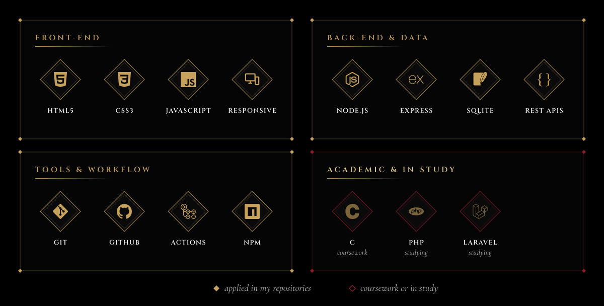
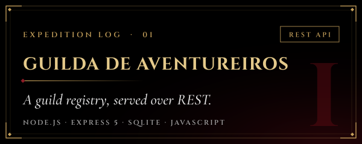
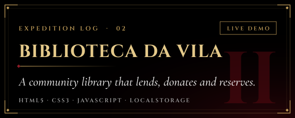
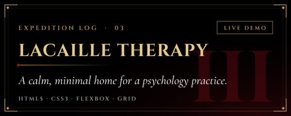
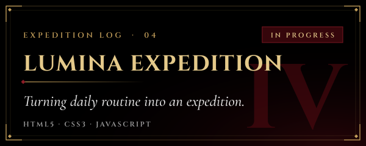

  

 

<!-- ═════════════════════════ I · THE EXPEDITIONER ═════════════════════════ -->

  <em>A Software Engineering student venturing through the frontier between imagination and code — 
  passionate about technology, driven by the desire to solve what others leave unsolved.</em>

  ◆ &nbsp;Studying <b>Software Engineering</b> at <a href="https://estacio.br/cursos/graduacao/engenharia-de-software">UNESA — Universidade Estácio de Sá</a> 
  ◆ &nbsp;IT Intern at <a href="https://www.angra.rj.gov.br/">Prefeitura Municipal de Angra dos Reis — RJ</a> 
  ◆ &nbsp;Building <b>REST APIs with Node.js &amp; Express</b> and front-ends in <b>plain JavaScript</b> 
  ◆ &nbsp;Next on the path: <b>PHP &amp; Laravel</b>

 

<!-- ═════════════════════════ II · PICTOS & LUMINAS ═════════════════════════ -->

  

 

<!-- ═════════════════════════ III · EXPEDITION LOGS ═════════════════════════ -->

<table>
  <tr>
    <td width="50%" valign="top">
      
      
REST API and web panel for a fantasy adventurers' guild. Full CRUD for heroes, items and missions, persisted in SQLite with foreign keys and cascading deletes, organized into routes and controllers and consumed by a plain-JavaScript front-end.

      
<b>Node.js · Express 5 · better-sqlite3 · JavaScript</b> 
      <a href="https://github.com/DevDavidFernandes/guilda-aventureiros-api">Repository&nbsp;↗</a>

    </td>
    <td width="50%" valign="top">
      
      
Academic project simulating a community library: register, edit, search, donate and reserve books. Built with DOM manipulation and LocalStorage persistence in a responsive interface.

      
<b>HTML5 · CSS3 · JavaScript · LocalStorage</b> 
      <a href="https://github.com/DevDavidFernandes/Biblioteca-da-vila">Repository&nbsp;↗</a> &nbsp;·&nbsp; <a href="https://devdavidfernandes.github.io/Biblioteca-da-vila/">Live demo&nbsp;↗</a>

    </td>
  </tr>
  <tr>
    <td width="50%" valign="top">
      
      
Multi-page website for a fictional psychology practice, reshaped from a generic clinic layout into a personal brand. Semantic HTML5 and CSS3 layouts with Flexbox and Grid, focused on clarity and accessibility.

      
<b>HTML5 · CSS3 · Flexbox · Grid</b> 
      <a href="https://github.com/DevDavidFernandes/Lacaille-Therapy">Repository&nbsp;↗</a> &nbsp;·&nbsp; <a href="https://devdavidfernandes.github.io/Lacaille-Therapy/">Live demo&nbsp;↗</a>

    </td>
    <td width="50%" valign="top">
      
      
Gamified productivity app where missions, journal entries and habits earn XP and levels. The interface is designed across landing, auth, dashboard, missions, journal and habits pages; the modular JavaScript architecture is scaffolded and its logic is in development.

      
<b>HTML5 · CSS3 · JavaScript</b> 
      <a href="https://github.com/DevDavidFernandes/lumina-expedition">Repository&nbsp;↗</a>

    </td>
  </tr>
</table>

  Also in the archive &nbsp;—&nbsp;
  <a href="https://github.com/DevDavidFernandes/Projetos-da-Faculdade">Projetos da Faculdade</a> (C coursework) &nbsp;·&nbsp;
  <a href="https://github.com/DevDavidFernandes/projetoaulas">projetoaulas</a> (Laravel study) &nbsp;·&nbsp;
  <a href="https://github.com/DevDavidFernandes/Projeto-Final-Parque-TECMAR">Parque TECMAR</a> &nbsp;·&nbsp;
  <a href="https://github.com/DevDavidFernandes/Curso-em-video-David">Curso em Vídeo</a> &nbsp;·&nbsp;
  <a href="https://github.com/DevDavidFernandes/meu-aprendizado-udemy">Udemy studies</a> &nbsp;·&nbsp;
  <a href="https://github.com/DevDavidFernandes/pokedex-mapa-dev-week">Pokédex Dev Week</a>

 

<!-- ═════════════════════════ IV · CHROMA RECORDS ═════════════════════════ -->

  
  &nbsp;
  

<picture>
  <source media="(prefers-color-scheme: dark)" srcset="https://raw.githubusercontent.com/DevDavidFernandes/DevDavidFernandes/output/github-contribution-grid-snake-dark.svg">
  
</picture>

 

<!-- ═════════════════════════ V · CORRESPONDENCE ═════════════════════════ -->

  
  &nbsp;&nbsp;
  

 

